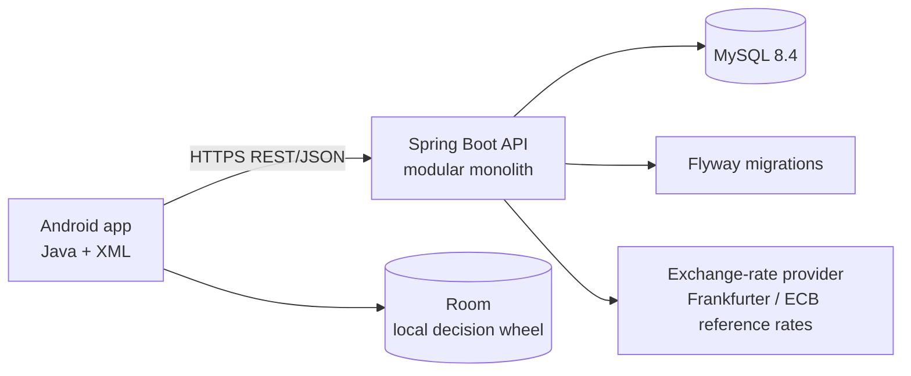
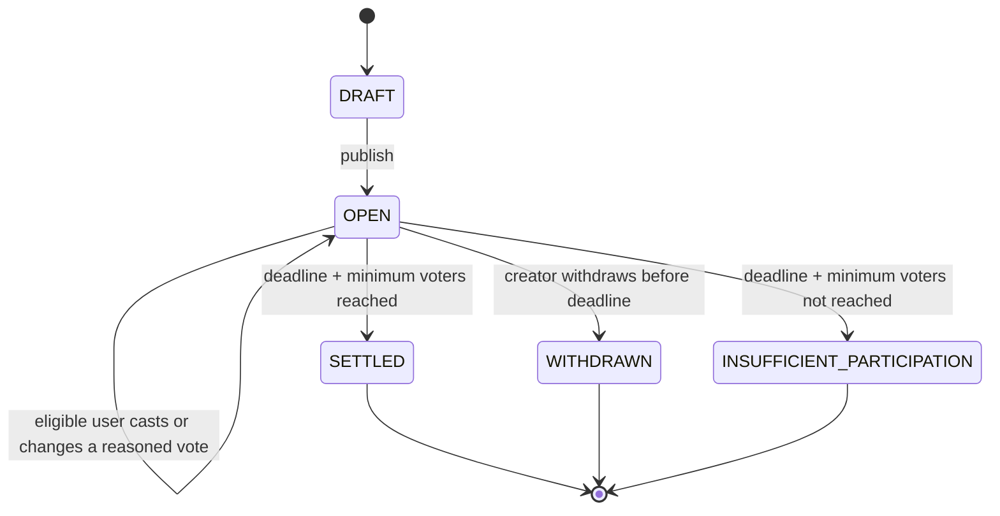
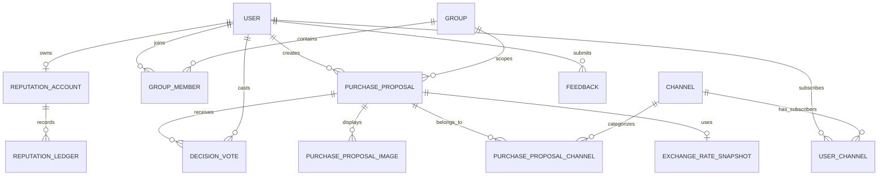

# Buy or Bye System Design

**Status:** Architecture baseline for team review
**Last updated:** 2026-11-02
**Repositories:** [`buyorbye-android`](https://github.com/SYSU-xjx/buyorbye-android) and [`buyorbye-backend`](https://github.com/SYSU-xjx/buyorbye-backend)

## 1. Purpose and Scope

`Buy or Bye` is an Android application for collaborative purchase decisions. A user posts an item they are unsure about buying, explains why they want it, and asks a group or the public plaza to decide whether to buy it. Each voter must explain their choice. The application also provides groups, personal records, reputation, weekly rankings, content controls, and a local decision wheel. These posts are purchase proposals, not formal approval requests.

The first implementation covers:

- Home dashboard and purchase proposal creation/drafts
- Group creation, invitation, membership, and group purchase proposals
- Public plaza feeds, channels, filtering, and interactions
- Personal profile and activity records
- Reputation and voting-weight display
- Weekly rankings with cross-currency conversion to HKD
- Local decision-wheel data on the Android device
- Authentication, authorization, loading states, error states, and empty states

Product details that are not explicitly settled in this document remain **To Be Confirmed (TBC)** and must not be encoded in a migration or API implementation without review.

## 2. Repositories and Technology Baseline

| Area | Choice |
|---|---|
| Android repository | `SYSU-xjx/buyorbye-android` |
| Backend repository | `SYSU-xjx/buyorbye-backend` |
| Android language | Java 17 |
| Android UI | One Activity, Fragments, XML layouts, Material components |
| Android baseline | `minSdk 24`, `compileSdk 37`, `targetSdk 37` |
| Android data/network | ViewModel/LiveData, Navigation Component, Retrofit, OkHttp, Gson, Room |
| Backend | Java 17, Spring Boot 3.5.5, modular monolith |
| Persistence | MySQL 8.4 LTS, Spring Data JPA, Flyway |
| Authentication | Spring Security, BCrypt, JWT (implementation pending) |
| API description | REST/JSON with OpenAPI |
| Local database | Docker Compose |
| Build checks | Android Gradle checks and Maven `verify` |

## 3. System Architecture



The Android app owns presentation state and the local decision wheel. The backend owns identity, authorization, purchase proposal state, voting, reputation, rankings, currency-rate snapshots, and server-side audit data. MySQL is the source of truth for server data. The backend may cache exchange rates later, but cached values must retain their source date and cannot silently rewrite historical results.

The backend remains a single deployable service. Packages are separated by business capability so that the team can work in parallel without introducing operational complexity from multiple services.

Suggested package boundaries:

```text
com.hku.money
  auth/
  user/
  group/
  proposal/
  plaza/
  reputation/
  ranking/
  exchange/
  feedback/
  common/
```

## 4. Android Client Structure

The initial shell uses four bottom-navigation destinations:

1. Home
2. Plaza
3. Groups
4. Profile

The decision wheel is entered from Home and stores its first-version data locally with Room. Server-backed screens should follow this flow:

```text
Fragment -> ViewModel -> Repository -> Retrofit service -> REST API
                         |                         |
                         +--> LiveData             +--> loading/error mapping
```

The emulator uses `http://10.0.2.2:8080/api/` to reach a backend running on the host machine. Production and physical-device URLs must be supplied through environment/build configuration and must not be committed with credentials.

## 5. Purchase Proposal and Voting Workflow

A `PurchaseProposal` has exactly one publication scope: `GROUP` or `PLAZA`. A draft is the same record in `DRAFT` status and may be incomplete. Publishing requires an item name, exact amount, currency, nonblank purchase reason, scope, deadline, and minimum voter count. An alternative-product tip is optional. A plaza proposal must belong to one or more public channels; a group proposal belongs to one group and no plaza channels. The creator cannot vote on their own proposal.



Confirmed rules:

- The creator chooses a deadline from one hour to seven days after publishing; the default is 24 hours.
- The creator sets a minimum number of participating voters; the default is 1. For a group proposal, the threshold cannot exceed the number of currently eligible group members other than the creator when published.
- Eligible users choose `BUY` or `NOT_BUY` and provide a nonblank reason. They may change their choice and reason before the deadline, but cannot withdraw a vote. Each change appends a `DecisionVote` event; only that user's latest event for the proposal counts.
- Group proposals are votable by current group members; plaza proposals are votable by authenticated users. Eligibility is checked when voting. A group member's existing vote remains valid after they leave, but they cannot cast another vote after leaving.
- The creator is excluded from the voter count and weighted result.
- Each vote event stores the voter's reputation level and weight snapshot at the time of that event.
- The minimum voter count uses distinct users' latest valid votes. At the deadline, if the threshold is met, a strictly greater than half weighted `BUY` vote produces result `BUY`; a tie or non-majority produces `NOT_BUY`.
- Lifecycle status and decision result are separate: `DRAFT`, `OPEN`, `SETTLED`, `WITHDRAWN`, and `INSUFFICIENT_PARTICIPATION` are statuses; only `SETTLED` has a `BUY` or `NOT_BUY` result. The result is `NULL` before settlement and for withdrawn or insufficient-participation proposals.
- The creator may edit the item, amount, purchase reason, and images only before the first vote. Once anyone has voted, those fields are frozen; the creator can still withdraw before the deadline and create a new proposal.
- A proposal can have up to six optional images. Image records store an object-storage URL and display order; the provider and per-image size limit are TBC.
- Public channels are system-managed; users may subscribe to them. One plaza proposal may appear in multiple channels, but it has one vote pool, one voter threshold, and one result. An all-plaza feed shows it once even if it belongs to multiple channels.
- Opening a proposal to view it is not a vote. The first version has no separate free-form comment or view-event record. Eligible viewers see only each voter's latest reason; earlier reasons remain available to that voter and for necessary audit access.
- Withdrawal stops new votes, is excluded from decision rankings, and creates no reputation score event. Existing vote events remain auditable.

## 6. Reputation and Voting Weight

When a proposal reaches the minimum voter count and is settled, a voter whose latest choice matches the final result receives `+1` reputation. Incorrect votes do not subtract points. Withdrawn and insufficient-participation proposals create no reputation event.

| Reputation score | Voting weight |
|---:|---:|
| 0–9 | 1x |
| 10–29 | 2x |
| 30+ | 3x (cap) |

The score change must be recorded in an append-only reputation ledger. The current account total is a summary that can be rebuilt from the ledger. The exact reputation transaction idempotency key and rule-version format are TBC.

## 7. Weekly Rankings and Currency Conversion

Rankings use the Hong Kong time zone and run from Monday 00:00 to the following Monday 00:00. The first version exposes:

- **Most NOT_BUY Decisions:** the creator with the most proposals settled as `NOT_BUY`
- **Highest Total BUY Amount:** the creator with the highest total amount for proposals settled as `BUY`
- **Most Votes Cast:** the voter with the most latest valid votes, counting at most once per proposal

All ranking amounts are converted to HKD. The selected source is Frankfurter's ECB reference rates. At proposal settlement, the backend stores the source, rate date, and applied rate used for conversion. If the provider is unavailable, the most recent saved rate may be used and its date must be recorded. A currency without any usable saved rate is excluded from amount rankings until a rate exists.

The ranking query should initially aggregate from fact tables. A materialized weekly snapshot is optional and requires a performance decision; it is not part of the initial schema.

## 8. Candidate Data Model

The following is the preliminary database model implemented by Flyway migration `V1__initial_schema.sql`. It is a starting point for team review, not a frozen production schema. Internal primary keys use auto-incrementing unsigned `BIGINT`; APIs should expose them as opaque identifiers and must not rely on their sequence.



Core candidate tables are `User`, `Group`, `GroupMember`, `PurchaseProposal`, `DecisionVote`, `PurchaseProposalImage`, `Channel`, `PurchaseProposalChannel`, `UserChannel`, `ReputationAccount`, `ReputationLedger`, and `ExchangeRateSnapshot`. `BlockedWord`, `BlockedUser`, and `Feedback` are additional candidates. `DRAFT` proposals use `PurchaseProposal`, so there is no separate `Draft` table. The first version does not require separate `View` or `Response` tables.

| Table | Key data and constraints |
|---|---|
| `PurchaseProposal` | Creator; `GROUP` or `PLAZA` scope; required group reference for `GROUP`; item name, exact amount, currency, nonblank purchase reason, optional alternative-product tip; status, nullable binary result, minimum voter count, deadline, and timestamps. Drafts may omit publish-required fields. |
| `PurchaseProposalImage` | Proposal, object-storage URL, and display order; no more than six images per proposal. |
| `PurchaseProposalChannel` | Proposal and channel pair; unique pair. Plaza proposals require at least one association when published; group proposals have none. |
| `DecisionVote` | Proposal, voter, binary choice, nonblank reason, reputation-level and weight snapshots, and event time. Each cast or change appends a row. The latest row per proposal/voter is the only effective vote. |
| `User` | Unique username, BCrypt password hash, optional display name/avatar, and active/anonymized account status. |
| `Group` / `GroupMember` | Group owner and hashed invite code; unique user/group membership with owner/member role and active/left/removed status. |
| `Channel` / `UserChannel` | System-managed channel and user subscription pair. |
| `ReputationAccount` | One current score per user, initialized to zero. |
| `ReputationLedger` | Append-only score change tied to a settled proposal, voter, and rule version; one reward per eligible final vote. |
| `ExchangeRateSnapshot` | Applied rate, source, rate date, and HKD conversion at settlement, where a rate is needed. |
| `BlockedWord` / `BlockedUser` | Per-user blocked word and blocked-user relationship; self-blocking is prohibited. |
| `Feedback` | Optional user reference, non-empty message, and open/in-progress/resolved processing status. |

Data design rules:

- Store monetary values as exact decimals with a separate currency code.
- Store vote choice and settled proposal result as `TINYINT UNSIGNED` with `CHECK (value IN (0, 1))`: `1 = BUY`, `0 = NOT_BUY`. The proposal result is nullable and must be non-null only in `SETTLED` state. API and Java code use `BUY` / `NOT_BUY`, not numeric values.
- Store server timestamps in UTC; convert to the user's display time zone at the edge.
- Keep business facts separate from summary values.
- Preserve every vote event, its reason, weight, and reputation-level snapshot for historical interpretation; only the latest event per voter/proposal participates in counting.
- Treat `DecisionVote` rows as append-only in application code; do not update or delete an earlier cast/change event.
- Enforce ownership, membership, vote validity, channel relationships, and image limits at the database and service boundaries as appropriate.
- MySQL enforces local row rules with foreign keys, unique keys, and `CHECK` constraints. Cross-row rules such as at least one channel for a published plaza proposal, group membership eligibility, and final-vote selection are enforced transactionally by the service.
- Use Flyway as the only schema-change path; do not use automatic JPA table creation.
- On account deletion, anonymize user identity while retaining the minimum proposal, vote, and reputation audit history. The precise retention period is TBC.

## 9. API Contract

The backend exposes versioned REST/JSON endpoints under `/api`. The endpoint list is a design target, not a frozen contract:

| Area | Candidate resources |
|---|---|
| Auth | `/api/auth/register`, `/api/auth/login` |
| Users | `/api/users/me`, `/api/users/me/records` |
| Groups | `/api/groups`, `/api/groups/{id}/members`, `/api/groups/{id}/invite` |
| Purchase proposals | `/api/purchase-proposals`, `/api/purchase-proposals/{id}`, `/api/purchase-proposals/{id}/votes` |
| Plaza | `/api/channels`, `/api/plaza` |
| Rankings | `/api/rankings/weekly` |
| Feedback | `/api/feedback` |

Contract conventions:

- JSON field names use `camelCase`; IDs are opaque strings or UUIDs once chosen.
- Errors use a stable error code, a human-readable message, and optional field details.
- Lists define explicit pagination, sorting, and filtering parameters.
- Mutating requests that can be retried should accept an idempotency key.
- Authentication uses `Authorization: Bearer <JWT>` after login.
- Choice and result values in JSON are `BUY` and `NOT_BUY`; every vote request contains a nonblank reason. Proposal publication requires item name, amount, currency, purchase reason, deadline, minimum voter count, and the scope-specific group or channels.
- OpenAPI examples are required before Android and backend parallel implementation begins.

The team must freeze the first API contract together with the first Flyway migration. Changes after the freeze require a short decision record and notification to affected modules.

## 10. Authentication and Authorization

The first version uses username/password registration and login. Passwords are stored only as BCrypt hashes. JWT signing material is supplied through an environment variable and is never committed. Access tokens are planned to expire after 24 hours; refresh tokens are not part of the first version.

Authorization checks apply to every resource, not just the UI:

- A group member can read group proposals while membership permits it and vote while membership is active. A vote cast before leaving remains valid.
- A plaza proposal is visible according to its publication and blocking rules; authenticated users can vote.
- A creator can edit proposal content only before the first vote and withdraw it only before the deadline.
- The group owner manages membership and invitation-code rotation.
- The creator cannot vote on their own proposal. Eligible viewers see only the latest reason for each voter's decision; vote history is restricted to the voter and necessary audit access.

Exact role names, blocked-user precedence, and audit-access roles remain TBC.

## 11. Local Development

Backend:

```sh
cp .env.example .env
docker compose up -d mysql
set -a && source .env && set +a
./mvnw spring-boot:run
```

Android:

```sh
./gradlew test lint assembleDebug
```

If encounter `Permission denied`, execute:
```shell
chmod +x gradlew
```

The backend repository's `compose.yaml` starts MySQL only. The service runs through Maven, and Android runs through Android Studio or Gradle. Flyway applies `V1__initial_schema.sql` when the backend starts against a new database; the team must review this preliminary schema before building business APIs.

## 12. Team Workflow and Responsibilities

Two members establish the repositories, database baseline, migration conventions, and shared development configuration. The remaining four members build feature modules on top of the reviewed baseline.

Before parallel implementation, the team reviews and accepts:

1. User flows and the purchase proposal state machine
2. ER diagram, data dictionary, constraints, and indexes
3. API list with request/response examples
4. Permission matrix and reputation/ranking rules
5. Initial Flyway migration and API mock/contract

Each repository uses feature branches and Pull Requests. `main` should reject direct pushes, require at least one teammate approval, and require the relevant CI checks. No license is added at this stage.

## 13. CI and Verification

Android CI runs `./gradlew test lint assembleDebug`. Backend CI runs `./mvnw -B verify`. The current scaffold has no business entities or integration tests; those should be added with the first reviewed contract.

Minimum feature verification should cover:

- Append-only vote history and latest-vote counting
- Minimum voter count and weighted settlement
- Frozen vote-weight snapshots
- Reputation-ledger idempotency
- Authorization for group, plaza, creator, viewer, and withdrawn states
- Publish-required fields, multi-channel deduplication, and the six-image limit
- Currency-rate fallback and HKD ranking calculations

## 14. Risks and Mitigations

| Risk | Mitigation |
|---|---|
| Rules change after schema/API work starts | Freeze a first contract; record changes as decisions |
| Weighted settlement is inconsistent under concurrent votes | Use a transactional settlement path and immutable vote snapshots |
| Exchange rates change historical ranking results | Store the applied rate and source date at settlement |
| Secrets enter public repositories | Use `.env`, environment variables, ignore rules, and CI secret storage |
| Five parallel branches drift | Require API/schema review and CI before merge |

## 15. Open Decisions

The following items remain open for review and may require follow-up migrations before the schema and API are frozen:

- Exact entity fields, indexes, and deletion/anonymization retention period
- Error-code catalogue, pagination format, idempotency-key scope, and API versioning policy
- JWT claim set, signing algorithm, and account recovery policy
- System channel management, detailed plaza visibility, and moderation behavior
- Object-storage provider, per-image size limit, and upload lifecycle
- Ranking tie display, privacy/anonymization, and whether weekly snapshots are needed
- Exchange-rate provider outage policy and supported currency list beyond HKD, CNY, and USD
- Group invitation expiry and maximum membership rules
- Whether the local decision wheel will later support server persistence or group sharing

No implementation should silently decide these items. Add the decision and update this document before changing the schema or public API.
